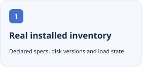
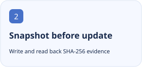
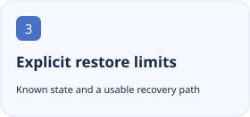

<p align="center"></p>

<h1 align="center">DSH Version Manager</h1>

<p align="center">Inspect plugins and Skills in the running profile, preview updates, record verifiable snapshots and show what can actually be restored.</p>

<p align="center">[简体中文](README.zh-CN.md) · [English](README.md)</p>

[](https://github.com/tangyixiao/dsh-version-manager/stargazers) [](https://github.com/tangyixiao/dsh-version-manager/actions/workflows/check.yml) [](LICENSE) [](https://www.npmjs.com/package/dsh-version-manager)

<p align="center">
  <picture><source media="(prefers-color-scheme: dark)" srcset="docs/assets/feature-1-en-dark.svg"></picture>
  <picture><source media="(prefers-color-scheme: dark)" srcset="docs/assets/feature-2-en-dark.svg"></picture>
  <picture><source media="(prefers-color-scheme: dark)" srcset="docs/assets/feature-3-en-dark.svg"></picture>
</p>

## Get started

Desktop: install the release `.tgz` through Extensions → Plugin Management → Add Plugin. For a Web profile you explicitly control:

```sh
dsh plugin --profile web add dsh-version-manager@0.1.3
```

Install into an existing Desktop/Web profile and open Version manager. Review inventory and the exact from → to update first; a new empty profile also needs the Web app bundle.

## Status and compatibility

| Item | Current source of truth |
| --- | --- |
| Source version | `0.1.3` · 以 [package.json](package.json) 为准 |
| Distribution | `npm` · [Releases](https://github.com/tangyixiao/dsh-version-manager/releases) |
| DSH | `>=0.2.2-rc.1` |
| Node.js | `>=22` |
| Development | [Open issues](https://github.com/tangyixiao/dsh-version-manager/issues?q=is%3Aissue+is%3Aopen) · [CI](https://github.com/tangyixiao/dsh-version-manager/actions) |

Restore is not a full backup: restoring a plugin version does not roll back configuration, the dependency tree or agent presets. Git, tarball and local sources require replay evidence.

[Detailed usage, configuration and troubleshooting](docs/guide.en.md)

## Development and participation

```sh
npm test
node tools/check-repository.mjs
```

[Contributing](CONTRIBUTING.md) · [Support](SUPPORT.md) · [Questions](https://github.com/tangyixiao/dsh-version-manager/discussions) · [Report a bug](https://github.com/tangyixiao/dsh-version-manager/issues/new/choose) · [Security](SECURITY.md) · [Maintenance](docs/maintenance.md)

## Star History

<picture><source media="(prefers-color-scheme: dark)" srcset="https://api.star-history.com/chart?repos=tangyixiao/dsh-version-manager&amp;type=date&amp;theme=dark&amp;legend=top-left"></picture>

[Interactive chart](https://www.star-history.com/?repos=tangyixiao%2Fdsh-version-manager&type=date) · [GitHub Stars](https://github.com/tangyixiao/dsh-version-manager/stargazers)

The external chart uses real star records and may be cached or unavailable; no development percentage is inferred.

## Origin and licenses

[Software license](LICENSE) · [Logo artwork and attribution](assets/NOTICE.md)

Software retains its existing license. Whale-girl derivative artwork is separately CC BY-NC-SA 4.0 with the attribution chain for 上善, ZipZipPipe and Small-tailqwq.
