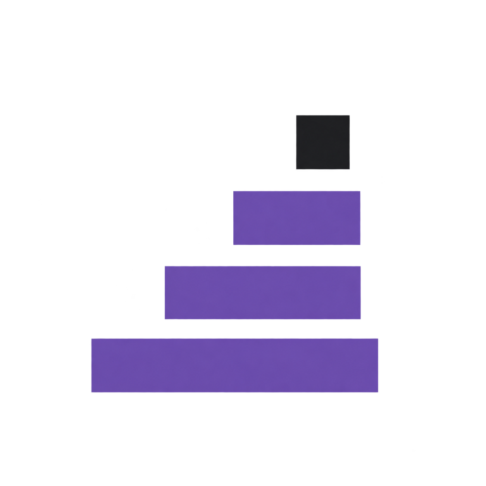

# Detailed usage and technical guide

Run commands from the repository root. Return to the [README](../README.md).

<p></p>

# dsh-version-manager

Version management for DSH plugins and Skills, inside DeepSeek Harness.

It answers four questions about the profile you are actually running:

1. **What is installed right now** — declared spec, installed version, where it came from, whether it loaded, whether it is compatible with this host.
2. **What an update would change** — the exact versions offered, with prereleases kept apart and deprecations shown.
3. **What the state was before the change** — a snapshot with a file fingerprint, written before the host is asked to do anything.
4. **Whether it can be undone** — and when it cannot, the specific reason instead of a retry button.

The panel is a sidebar entry (`版本管理` / `Version manager`) with two tabs: plugins and Skills. It is a normal DSH bundle: nothing is patched into the host, no DOM is injected, and no private API is reached for.

## Install

```bash
dsh plugin --profile <your-profile> add dsh-version-manager@<version>
```

From a local tarball:

```bash
npm pack
dsh plugin --profile <your-profile> add /absolute/path/dsh-version-manager-<version>.tgz
```

Then restart the host and open the panel from the left sidebar.

One prerequisite is worth knowing before you install into a *brand new* profile. `dsh plugin --profile <new> add …` creates a profile whose bundle list is just `@deepseek-ai/dsh-base`. A panel plugin needs `webServer`, which arrives with `@deepseek-ai/dsh-web-app`; without it this plugin sits in `pending (waiting for service: webServer)` and never draws anything. Desktop profiles already carry that bundle, so installing into the profile you already use is unaffected. Into an empty profile, add the web app bundle too.

Verify the bundle was installed from the tarball rather than from a stray checkout:

```bash
node -e "console.log(require('fs').readFileSync('<profile>/node_modules/dsh-version-manager/package.json','utf8'))"
```

## What it does

### Plugins tab

One row per entry the host reports, with the fields the host actually provides:

| column | meaning |
| --- | --- |
| package | the entry name the loader knows |
| installed version | the version on disk, or `未知` when the host does not know it |
| source | the declared spec, classified: registry, git, tarball, local path, alias, built into this profile, or unknown |
| load state | the loader phase: active, pending, loading, failed, unloading |
| compatibility | whether the package's own DSH version requirement is satisfied by this host |
| actions | check updates, take a snapshot |

Three states are kept apart on purpose, because collapsing them produces false confidence:

- **satisfied** — the package declares a DSH requirement and this host meets it.
- **no requirement declared** — the package declares nothing. This is not a pass; it is the absence of a claim, shown with a neutral dot.
- **unknown** — the requirement exists but could not be evaluated (for example the running version is unreadable), or the installed manifest was not read.

**Check updates** asks the host for versions newer than the installed one. Stable and prerelease are separate lists; a prerelease requires an explicit opt-in, and a row shows whether the version is still a bundle, whether it is deprecated, and what its compatibility verdict is.

The summary line above the table counts entries the host would let this plugin write (**writable** or 可写入), not entries that have a newer version. Those are different questions: only a per-target version check can answer the second one, and the panel does not pretend to know it in advance. A writable row with nothing newer available is the normal case, not a contradiction.

**Update** always shows the from → to pair plus the four side effects before it runs:

- a snapshot is written first and read back before anything else happens;
- the host saves the target as an *exact* version, so a declared range is replaced;
- configuration, the dependency tree and agent presets are **not** rolled back;
- the host is not restarted.

### Snapshots and restore

A snapshot records the profile identity, package name, original declared spec, installed version, source (including the registry host when the lockfile records one), enabled state, compatibility verdict, and a SHA-256 fingerprint of the package directory. It does **not** record tokens, credentials, environment variables or file contents.

Snapshots live under `<DSH_HOME>/version-manager/snapshots/<profile>/<package>/`, are written through a temporary file and renamed into place, never overwrite an existing snapshot, and are kept at 20 per target. Anything older than that stays restorable and is labelled as past retention rather than deleted for you; see [Retention](#retention-is-visible-and-nothing-is-deleted-for-you).

Restore is offered only when it can actually work, and only reports what happened:

| reply | meaning |
| --- | --- |
| `alreadyAtVersion: true` | the profile already carries that version; nothing was reinstalled |
| `ok: true` + `evidence.filesMatch: false` | the files had changed (normally because an update ran) and the recorded version was reinstalled |
| `409 source-not-replayable` | the snapshot came from a git, tarball or local-path install, so reinstalling it by version would be a different artifact |
| `409 source-substitution` | the snapshot belongs to a different package name |
| `409 not-installed` | the package directory cannot be read, so nothing can be fingerprinted |

Restore is **version only**. It does not roll back configuration, the dependency tree or agent presets, and it does not restore files that were edited by hand.

A restore is a write, so it also leaves a way back: before reinstalling, it snapshots the version it is about to replace (marked `before restore to <version>`) and reads that snapshot back. The reply carries it as `undo`. Without it, restoring would be the one action in this plugin with no return path — the version you were on would be gone the moment it ran. A restore that finds the profile already on the recorded version changes nothing and writes no extra snapshot.

### Skills tab

Skills have no version field, so the panel does not invent one. For each Skill the host reports, it shows the source (project `.dsh/skills`, project `.agents/skills`, custom directories, user `.dsh/skills`, user `.agents/skills`, bundled), the file count, and the Git revision when the directory is inside a checkout, along with whether the Skill's own directory has uncommitted changes.

**Take a snapshot** copies the Skill directory into the snapshot store, re-reads the copy, and refuses to keep it when the copy does not match the digest of what was read. The snapshot records bytes plus the Git revision the directory happened to be at; it never presents either as a version number.

**Restore** puts one Skill directory back to the exact bytes a snapshot recorded. Open a row's snapshot list, preview, and confirm. The preview runs before the confirmation bar, so a refusal is something you read while choosing rather than after committing. A restore is refused when:

| reason | meaning |
| --- | --- |
| `inside-git-checkout` | the directory is inside a Git working tree; this plugin never rewrites tracked files and never runs `git checkout`, `reset` or `clean` |
| `system-skill` | the path contains a `.system` segment, which the host does not discover either |
| `bundled-skill` | the Skill ships with DSH |
| `snapshot-directory-mismatch` | the snapshot records a different directory, even if the Skill has the same name |
| `snapshot-copy-corrupt` | the stored copy no longer matches its manifest digest, so it is not a baseline |
| `snapshot-copy-missing` | the stored copy is gone |
| `no-directory` | a single-file Skill has no directory to swap |

A restore that proceeds keeps a way back: it snapshots the current directory first (marked `before-restore`, shown as an "undo point"), assembles the replacement in a sibling staging directory on the same volume, re-verifies it against the same digest, and only then swaps it in with two renames — parking the old directory rather than deleting it first. Files added after the snapshot are removed: a restore is the recorded tree, not a merge with what is on disk now. The response reports `undo` so the step you just replaced can itself be restored.

The `.system` directory and anything outside the host's Skill catalog are never scanned or written. A snapshot or restore request can only name a Skill the host lists — the routes never accept a path, so they cannot be used as a directory copier.

> One consequence worth stating plainly: the host's filesystem provider is disabled in a stock profile, so in a default profile the Skills tab lists only bundled Skills unless that provider is enabled. The plugin reports `available: false` with the host's own reason rather than showing an empty list.

### Git-managed Skills

A Skill has no version field, so the only honest way to say "which content is this" is the commit it came from. Register a Skill once — name, repository, the exact subpath inside it, and a branch or tag — and the panel can then show what an update would change, move the directory forward, and move it back to any commit already fetched.

The plugin never runs a Git command inside your checkout. It keeps its own bare repository at `<DSH_HOME>/version-manager/git-cache/<hash>.git` and does every read there: `fetch` into that cache, `ls-tree` and `cat-file blob` to write files, `diff --name-status` to say what would change. Your branches, index and working tree are not touched, so there is nothing for this feature to corrupt outside the one Skill directory it was pointed at.

What an update does, in order: verify the directory still matches the digest recorded at registration, fetch the ref into the cache, diff the trees, snapshot the current directory (reason `before git update to <sha>`), export the tree into a sibling staging directory, re-verify it, swap it in with two renames, then record the new revision and digest. Moving back to an earlier commit is the same path with the revision named explicitly.

It refuses, by name, when:

| reason | meaning |
| --- | --- |
| `local-modifications` | files in the directory no longer match the recorded baseline; the update would silently discard someone's work |
| `baseline-unknown` | the directory holds files that are not that commit's tree, so no honest baseline can be recorded at registration time |
| `inside-git-checkout` | the target directory is inside a working tree |
| `bundled-skill` | the Skill ships with DSH |
| `system-skill` | the path contains a `.system` segment |
| `bad-subpath` | the subpath is absolute, contains `..`, or points into `.git` |
| `unsupported-remote` | the address is not `https`, `ssh`, `git@`, `file://` or an absolute path |
| `already-registered` | the Skill is already registered to a different source; unregister first, so history cannot become fictional |
| `revision-not-in-cache` | the requested commit was never fetched; the plugin does not guess or rewrite history |
| `unsupported-entry` | the commit contains a symlink or a submodule. Writing a symlink as a regular file would change what the Skill means |

Registration itself writes one line to a registry file and nothing else — a claim about intent should not be able to destroy content. The first update is what fills the directory, which is also why a freshly registered empty directory reports `populated: false` instead of claiming it is already at that revision.

Moving back is allowed in one case where moving forward is not: if you edited the files by hand, an update is refused (`local-modifications`) but a restore still runs, because a restore snapshots the current directory before it writes. Refusing both would leave no way back from the exact situation this feature exists to fix. A restore does still refuse a directory this plugin never populated that now holds files — those belong to something else, and replacing them would delete files the plugin has no record of. The panel reports the two refusals separately (`refusal` and `restoreRefusal`).

Sources that are **not** supported, listed rather than implied: any directory this plugin did not create or verify (registration requires an empty directory or an exact match to the named commit), a subpath containing symlinks or submodules, a repository reachable only over a transport Git itself cannot read here, and a Skill whose directory lives inside another Git checkout.

## Verification

Three kinds of evidence, kept apart on purpose.

**Unit and integration tests.** `npm test` runs 141 tests with no network and no host: spec classification, semver comparison, lockfile parsing, inventory merging, snapshot store, snapshot retention and pruning, operation journal, path-segment encoding, host location, Skill restore (including a swap that fails halfway), the Git-managed Skill flow against real throwaway repositories, and the HTTP routes wired against a fake host.

**CI.** `.github/workflows/check.yml` runs that suite on Ubuntu, Windows and macOS against Node 22 and 24 — six jobs, no install step, because the package has no dependencies. It also runs `npm pack --dry-run` so a broken `files` list fails the build.

**A real host.** The flows below were run against DeepSeek Harness `0.2.2-rc.1` (Electron 44.7.0, Node 24.21.0) on Windows 11, installed from the packed tarball into a throwaway `DSH_HOME`. The point of a separate home is that a mistake here cannot touch the profile you work in.

What was exercised, and what it produced:

| step | observed |
| --- | --- |
| fresh profile created by `dsh plugin --profile final add <tarball>` | `dsh: initialized profile final`, the packaged version reported by the host, 26 rows rendered |
| `GET /overview` | `profile=final`, `host=0.2.2-rc.1`, source `@deepseek-ai/dsh-app-boot/package.json` |
| `POST /snapshot` without `confirm` | `400 {"error":"confirm required"}` |
| `POST /snapshot` with `confirm` | `200`, snapshot written with `seq: 1` |
| `POST /update` on a registry plugin | `200`, host reported `1.7.2 → 1.7.3`, snapshot taken first, operation journal reached `succeeded` |
| `POST /restore` with that snapshot | `200`, `restoredVersion: 1.7.2`, `evidence.filesMatch: false` (the files *had* changed, which is the expected evidence) |
| `POST /skills/snapshot` | `200`, copy re-read and verified, `fileCount: 2` |
| Skill restore on a bundled Skill | `409 bundled-skill`, directory unchanged |
| Git-managed Skill: register, first apply, update A→B, restore A, hand-edit then restore | registered against an empty directory (`populated: false`), first update filled it, an update moved `8569b20 → c3d0909` with `M SKILL.md` / `A extra.md`, a restore put `8569b20` back and removed `extra.md`, a hand-edited file made the update refuse `local-modifications` while the restore still ran and left an undo snapshot holding the edited bytes |
| retention, driven from the panel of the **published** 0.1.2 | three snapshots past the limit made the row read `23 份快照，其中 3 份超出每个目标保留的 20 份。超出的不会自动删除，仍然可以恢复。` with three `超出保留数` badges and a `删除超出的快照` button; the confirmation named the target and the count; after confirming, the panel said `已删除 3 份超出保留数的快照，现在剩 20 份。`, `/overview` reported `{stored: 20, beyondLimit: 0}`, and exactly three files were gone from disk (oldest remaining `0006-…`) |
| lifecycle: install, disable, uninstall, reinstall | disabling needed `- id: version-manager` / `disabled: true` in the profile's `cordis.patch.yml` (the CLI has no enable/disable); after uninstall the sidebar entry was gone and the snapshot store was untouched; reinstalling brought back every snapshot and operation |
| the Desktop shell | sidebar entry, panel, both tabs, confirmation bar, operation list and snapshot list all rendered and worked; a snapshot taken by clicking in the UI landed on disk |

Two defects found this way and fixed rather than documented away: a nested-but-successful host reply was being classified as a failure, and a bundled Skill could be offered a restore the plugin would refuse everywhere else. A third was cosmetic but worse than cosmetic — one local path was compared in two spellings and reported as a change that never happened. A fourth came out of the Git flow: the panel reported a freshly registered, still-empty directory as "modified, update will be refused" because the empty directory's digest never equals the commit's, while the update path allowed it — the row now reads the same refusal function the update path uses, so the two cannot drift apart again. A fifth was found by installing the published package: the panel said "2 updatable" for two rows that had no newer version at all, because the number was counting rows the host would accept a write for. The field and its labels now say **writable** — what is actually measured. A sixth came from asking which modules had no test at all: `operations.js` and `locate.js` had none, and writing the first test for the journal found that `encodeSegment('..')` returned `..`, so `path.join(root, '..')` climbed out of the plugin's own store. Four modules each had their own copy of that encoder. They now share one, which treats a name made only of dots as dots-that-are-not-a-path. The ordinary names are untouched — a test pins `desktop` → `desktop` and `team/blue` → `team%2Fblue`, because a stricter encoding would silently move every snapshot already on disk.

Not verified: another DSH version, a Linux or macOS Desktop, and a non-bundled Skill provider.

### Keyboard and accessibility

Audited against the P4 checklist. Four defects were real, not hypothetical, and the fix lives entirely in `lib/client.js`:

| defect | effect | fix |
| --- | --- | --- |
| the strip had `role="tablist"` and `role="tab"` but no keyboard behaviour | both tabs sat in the tab order and the arrow keys did nothing — a tablist is one stop, not two | roving `tabindex`, ArrowLeft/ArrowRight with wraparound, Home and End; focus follows the selection |
| `aria-controls` pointed at an element that did not exist | there was no `role="tabpanel"` at all | one stable `#vm-panel` with `role="tabpanel"` whose `aria-labelledby` follows the selected tab, so every tab's `aria-controls` resolves |
| every row rendered the same two button names | dozens of identically named buttons in the accessibility tree — "check versions" says nothing about *which* package | per-row accessible names, e.g. `check versions: @deepseek-ai/dsh-base` |
| two different buttons were both "refresh" | the plugin list and the Skill catalog were indistinguishable | the Skill one is named in its `aria-label`; the visible word is unchanged |

The row expander also stopped being announced as a triangle (`▸ dsh-update-checker`): it now reads `show details: <package>` / `hide details: <package>`, alongside the `aria-expanded` it already had.

Measured on the real host in an isolated `DSH_HOME` (Desktop 0.2.2-rc.1) over CDP with real `Input.dispatchKeyEvent` events rather than synthetic `dispatchEvent` calls: one tablist stop instead of two; ArrowRight moves focus and `aria-selected` together and the panel label follows; ArrowRight again wraps; End and Home jump; Enter and Space open and close the expander with the name flipping; the focus ring is present (`outline: auto 2px`, `:focus-visible` matches) because nothing in the bundle removes it; and this plugin contributes no unnamed and no duplicate-named controls (the only repeated name on the page belongs to the host).

Not claimed: no screen-reader session (NVDA or Narrator) was run — the statements above are about the accessibility tree and keyboard behaviour as measured through CDP, not about how a particular screen reader voices them. Windows only. Contrast was not measured; the panel adds no text colours of its own beyond the status dots and badges.

## Honest limits

- **A snapshot is not a profile backup.** A version restore reinstalls one package. It does not revert `package.json` ranges, the lockfile, config overlays, or the dependency tree.
- **Registry host is often unknown.** pnpm's lockfile records a tarball URL only for some packages; when it does not, the panel says the registry is not stored rather than assuming npmjs.
- **Compatibility uses the package's own declaration.** If a package declares nothing, the panel says so instead of guessing.
- **Skill writes are one direction per flow.** A snapshot restore replaces a directory with recorded bytes; a Git update moves a registered directory between commits. Neither merges: what is on disk and not in the target tree is removed. A directory the plugin did not register has no baseline, and the plugin will not guess one.
- **A Skill snapshot is a copy, not a version.** Skills have no version field, so the store keeps bytes and the Git revision separately; it never presents them as a version number.
- **Git-managed Skills need Git on `PATH`.** The flow shells out to `git` for `fetch`, `ls-tree` and `cat-file`. When Git is missing the panel says `git-not-found` instead of falling back to a filesystem copy.
- **`skippedBundles` is not visible at runtime.** DSH prints bundles it skipped to stderr at startup; a running plugin cannot read that list, so a bundle that never loaded is reported from the loader's own phases, with `unknown` where the host is silent.
- **Tested on Windows only** as a real host (0.2.2-rc.1, Electron 44.7.0, Node 24.21.0). Linux and macOS are covered by the unit tests, not by a running Desktop.

## Security

- Every route requires a DSH owner session (`connection.admit`); there is no unauthenticated surface.
- Every write route requires `{"confirm": true}` in the body, so a stray GET or a cross-site form post cannot change anything.
- The host, not this plugin, writes the profile. Updates go through the host's plugin manager, which owns the manifest lock and its own log.
- Skill snapshots copy only directories the host catalog lists. No request-supplied path is read, and snapshot file names are rejected when they contain `/`, `\` or `..`.
- A Skill restore is the only path that writes into a user directory without an explicit commit. It refuses Git checkouts and `.system`, verifies both the stored copy and the staged replacement against one digest, and snapshots what it replaces first.
- A Git update writes the tree of a commit you named, into a directory you registered. The fetch goes to a bare cache the plugin owns (`<DSH_HOME>/version-manager/git-cache/`); no command runs inside your checkout, and the skills' own Git state is read, never changed. A directory whose files drifted from the recorded baseline is refused rather than overwritten — except by a restore, which is the documented way back and snapshots what it replaces first.
- Nothing is uploaded. The panel reads only what the host and the local filesystem expose.

## Routes

All under `/dsh-version-manager`, same-origin, `Cache-Control: no-store`.

| method | path | body | purpose |
| --- | --- | --- | --- |
| GET | `/overview` | — | profile, host version, plugin rows, recent operations |
| GET | `/versions?target=<name>` | — | newer versions, split into stable and prerelease |
| GET | `/skills` | — | Skill inventory with snapshot counts, a `restoreRefusal` per row, and the Git registry |
| GET | `/skills/restore-preview?name=&file=` | — | what a restore would do, and every reason it would be refused |
| GET | `/skills/git` | — | registered Git sources, their pinned revision, local drift, and separate `refusal` / `restoreRefusal` |
| POST | `/snapshot` | `{targetId, confirm}` | snapshot one plugin |
| POST | `/snapshots/prune` | `{targetId, confirm}` | delete the snapshots past the per-target limit, listing every file removed |
| POST | `/update` | `{targetId, toVersion, allowPrerelease?, confirm}` | snapshot, then ask the host to update |
| POST | `/restore` | `{targetId, snapshotId, confirm}` | reinstall the version a snapshot recorded |
| POST | `/skills/snapshot` | `{name, confirm}` | snapshot one Skill |
| POST | `/skills/restore` | `{name, file, confirm}` | replace one Skill directory with the recorded bytes |
| POST | `/skills/git/register` | `{name, remote, subpath?, ref?, create?, confirm}` | record where a Skill comes from and the commit it currently matches |
| POST | `/skills/git/remove` | `{name, confirm}` | forget the registration, leaving the directory alone |
| POST | `/skills/git/preview` | `{name, ref?, confirm}` | fetch into the plugin's cache and report the diff and every refusal |
| POST | `/skills/git/update` | `{name, ref?, confirm}` | snapshot, then write the tree of the fetched commit |
| POST | `/skills/git/restore` | `{name, revision, confirm}` | snapshot, then write the tree of a commit already in the cache |

Error bodies carry a stable `error` code and, when useful, a `message`. The update and restore flows also return `operationId`, and the operation journal under `<DSH_HOME>/version-manager/operations/<profile>/` records each transition: `planned`, `snapshot_verified`, `applying`, `verifying`, then `succeeded`, `failed`, `cancelled` or `recovery_required`.

## Performance and cache policy

Measured in a real Windows Desktop host (0.2.2-rc.1, Electron 44.7.0, Node 24.21.0) against a
profile with 26 plugin rows, 11 stored snapshots and 8 visible Skills. Timings are
`fetch()` round trips taken inside the panel's page, so they include the host's own
serialization:

| call | cold | warm |
| --- | --- | --- |
| `GET /overview` | 161 ms | 134 ms |
| `GET /skills` | 426 ms | 313 ms |

There is nothing slower here by design. What costs time, and why:

- **`/overview` reads the filesystem per row.** For each package it reads the installed
  manifest, the profile manifest, the lockfile entry and the stored snapshot list. That is
  why it is one call and not one call per row: the panel refreshes everything at once.
- **`/skills` is the slower one** because the host's skill catalog is scanned by the host
  itself; the plugin only aggregates what the host already enumerated.
- **No caching of version lists anywhere.** `/versions?target=…` asks the registry through
  the host every time it is pressed. A cached answer would be indistinguishable from a
  fresh one in the panel, which is exactly the failure this plugin exists to avoid.
- **The only on-disk caches** are the snapshot store
  (`<DSH_HOME>/version-manager/snapshots/<profile>/<pkg>/`) and, for Git-managed Skills, a
  bare repository per remote (`<DSH_HOME>/version-manager/git-cache/<hash>.git`). Both are
  yours to delete when the plugin is not running; the plugin recreates what it needs.

### Retention is visible, and nothing is deleted for you

Every target keeps its snapshots. The panel states the numbers: how many exist, how many
are past the 20-per-target limit, and which ones. Rows past the limit are labelled
**超出保留数 / past retention** in the list.

They are **not** removed automatically. A version manager that silently deletes the way
back is worse than one that keeps too much, so removal is one explicit action with its own
confirmation, which states how many files it will delete before it does it:

```
POST /snapshots/prune  { targetId, confirm: true }
```

The response lists every removed file, every file it failed to remove, and how many remain.
A snapshot still in the list can still be restored.

## Troubleshooting

| symptom | what it means | what to do |
| --- | --- | --- |
| Sidebar has no **Version Manager** entry | the plugin did not activate | `dsh --profile <p> --no-open` prints the entries that did not activate; a fresh profile usually reports `pending (waiting for service: webServer)` — see [Install](#install) |
| Panel opens but every row says `unknown` compatibility | the installed manifest could not be read for those packages | the row's `加载状态` detail names the reason; `unknown` is deliberately not rendered as a pass |
| `registry 未知` on a package | pnpm's lockfile stored no tarball URL for it | nothing is broken; a version check still works, but this plugin will not guess which registry host to record |
| A row is read-only and offers no update | the host itself keeps that entry read-only (official bundles, or an `install` source the plugin must not rewrite) | the row shows the host's own reason; updates to those entries are not attempted |
| Update answers `not-updatable` | the row was writable at render time but not when the request arrived | press refresh; if it stays read-only, the host changed its mind and the panel is telling you |
| Update answers `already-installed` | the host reached the target without changing anything | this is reported as a failure on purpose: nothing was applied, so nothing is claimed as applied |
| Restore answers `409` | a precondition failed | the body's `error` is a stable code (`source-not-replayable`, `not-installed`, `snapshot-incomplete`, …) and `evidence` shows what was compared |
| `evidence.filesMatch: false` after a restore | the files on disk differ from the snapshot's recorded fingerprint | expected when the package's files change between versions; it is evidence, not a veto |
| Skill tab says the skills service is unavailable | the host exposes no skill provider in that process | the panel prints the host's own reason; the Git-managed section still works, because it does not need the catalog |
| Only bundled Skills are listed | `skill-filesystem` is `disabled: true` in a stock profile | enable that provider in the profile to see your own Skill directories |
| `git-not-found` | Git is not on `PATH` for the host process | install Git; the Git Skill flow refuses rather than copying files without it |
| `local-modifications` | files changed since the registered baseline | update refuses; `回到这个 commit` (restore) still works and snapshots the current bytes first |

## Upgrade and uninstall

Upgrade in place — the profile manifest and the stored snapshots both survive:

```bash
dsh plugin --profile <profile> add dsh-version-manager@<newer-version>
```

Reinstalling the **same** version is the one case pnpm short-circuits
(`Already up to date`, files not replaced). Remove first, then add:

```bash
dsh plugin --profile <profile> remove dsh-version-manager
dsh plugin --profile <profile> add dsh-version-manager@<version>
```

Uninstall removes the code, not your data:

```bash
dsh plugin --profile <profile> remove dsh-version-manager
```

Verified in an isolated profile: after a remove, `node_modules/dsh-version-manager` was
gone and the `dependencies` / `dsh.profile.bundles` entries with it, while
`<DSH_HOME>/version-manager/` still held every snapshot and operation record (19 files
before and after). Reinstalling brought the panel back with the same 11 snapshots and 8
operations. Delete `<DSH_HOME>/version-manager/` yourself to remove that history.

Disabling without uninstalling uses the host's own patch file — add the row's `id` with
`disabled: true` to `<DSH_HOME>/profiles/<profile>/cordis.patch.yml`, then restart:

```yaml
- id: version-manager
  disabled: true
```

The panel disappears from the sidebar and nothing runs. There is no enable/disable
subcommand in the DSH CLI (`dsh plugin` only forwards `add` / `remove`); the patch file is
the supported way. Verified in an isolated profile, both directions.

## Compatibility

| DSH | status |
| --- | --- |
| 0.2.2-rc.1 (Windows Desktop shell, Electron 44.7.0) | verified in a real host: sidebar entry, panel, plugin inventory, update, snapshot, restore |
| other 0.2.x | expected to work; the extension points used (`sidebar.panellist`, `main`, `webServer.register`, `pluginManager`, `skills`) exist across 0.2.x, but they were not exercised against another build |

## Development

```bash
npm test          # node --test, no build step
```

The panel is a hand-written browser bundle (`lib/client.js`) using the `window.__ModuleLoader__.load` contract, with `react` as its only external. The host half is plain ESM under `lib/host/`.

- `docs/baseline.md` — the P0 survey: what this host version actually exposes, what was verified against the running installation, and what could not be verified.

## License

MIT. See [LICENSE](../LICENSE).
